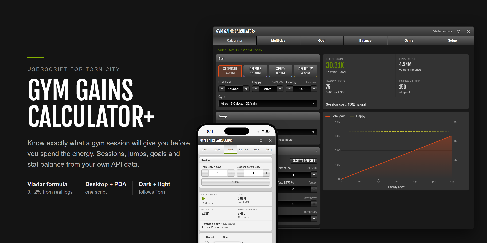
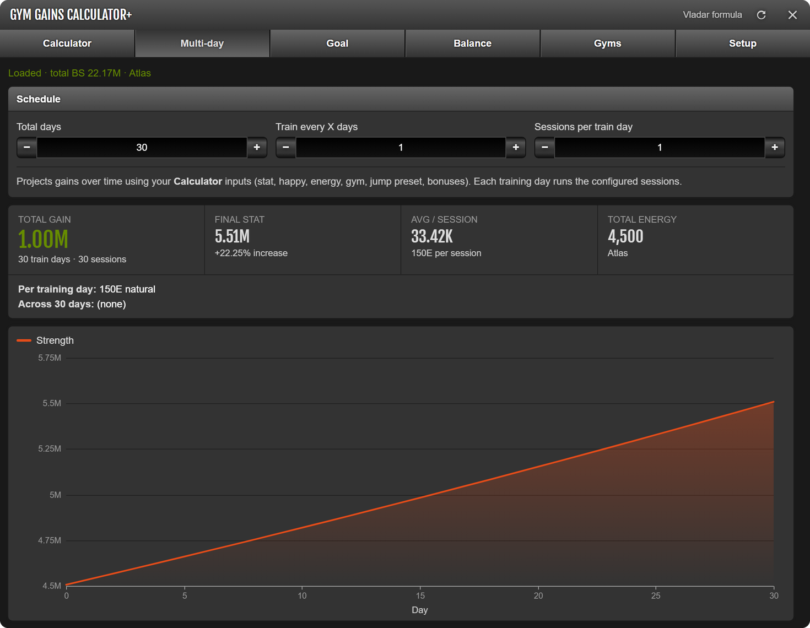
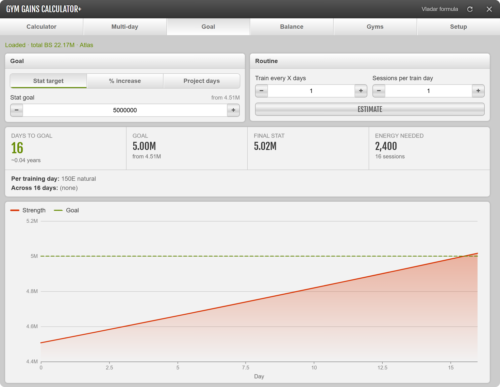
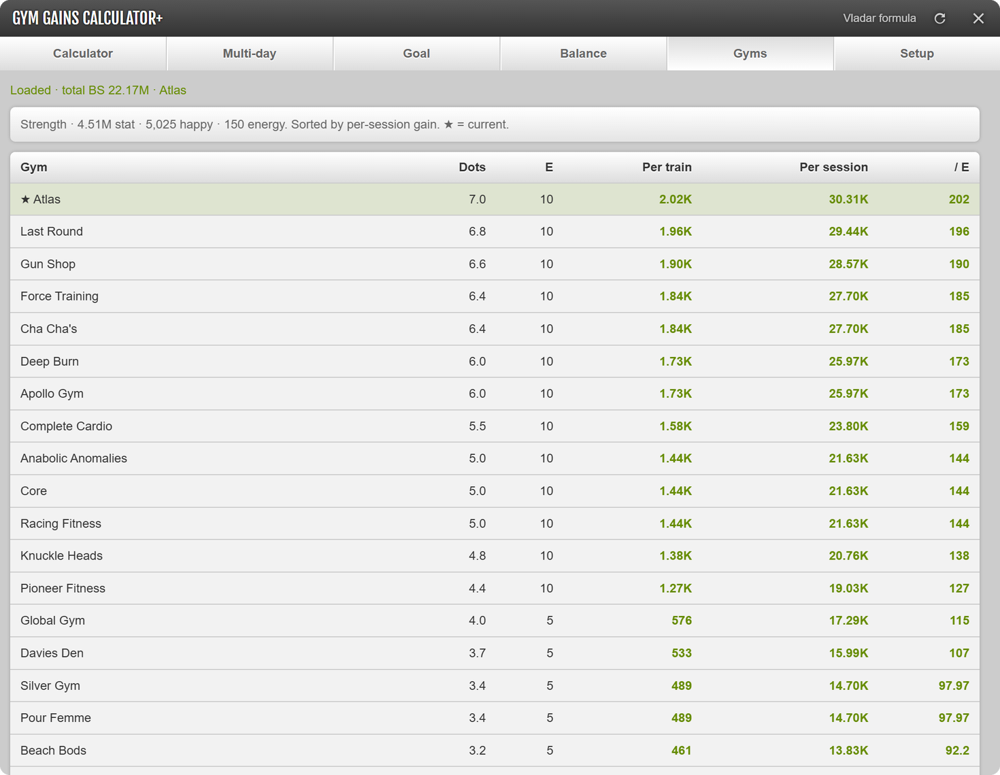
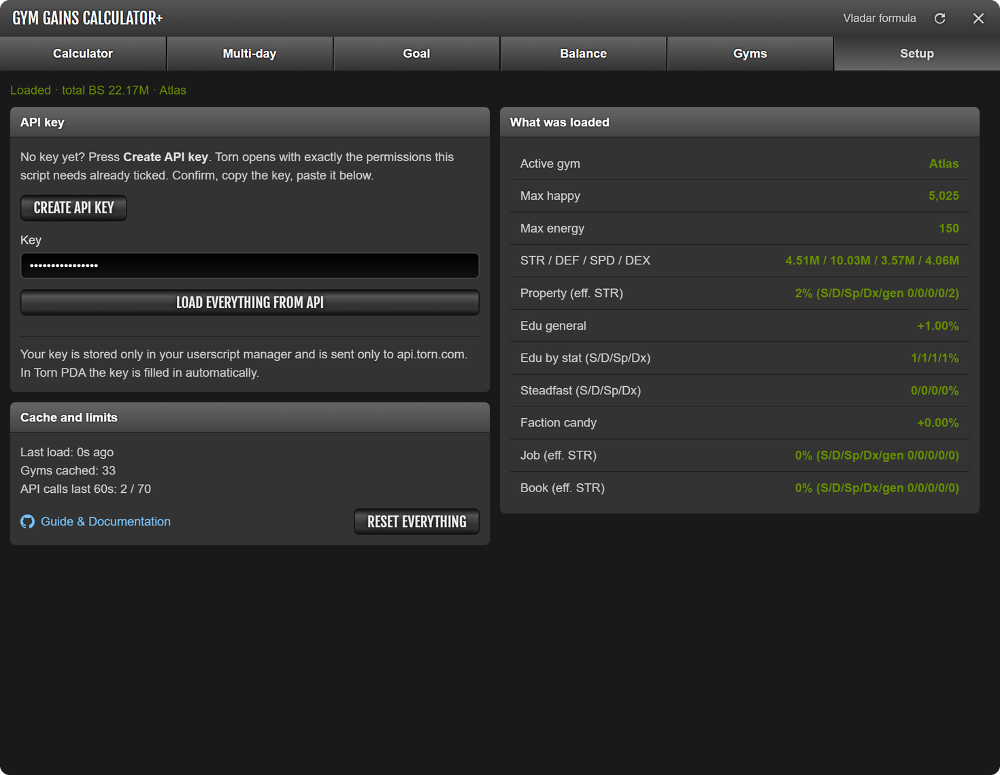
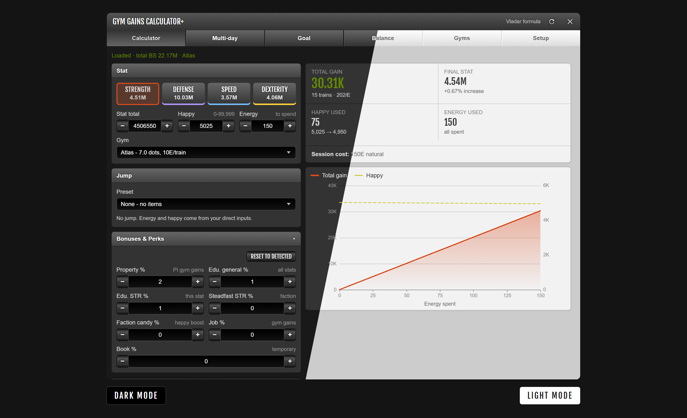
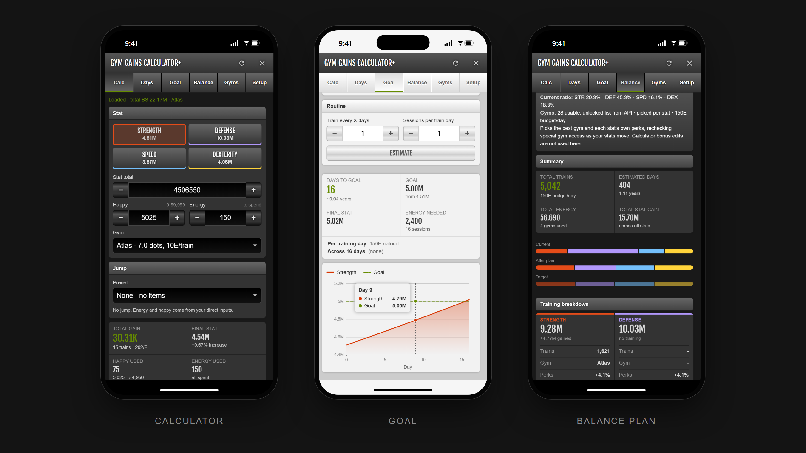
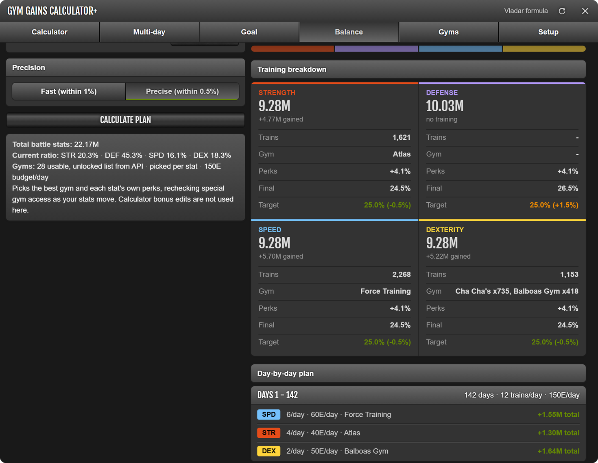

<div align="center">



<br>

<a href="https://greasyfork.org/scripts/575551"></a>


<br>

[Install](#install) · [Features](#features) · [Mobile](#mobile-and-torn-pda) · [Balance planner](#balance-planner) · [Formula](#the-formula) · [FAQ](#faq) · [Changelog](#changelog)

</div>

<br>

Torn never tells you what a gym session is worth. Gym Gains Calculator+ does. It reads your stats, happy, energy, gyms and perks from the Torn API, simulates every single train with Vladar's formula, and shows you the result before you spend a point of energy.

It lives on `torn.com/gym.php`, looks like part of the game, and runs entirely in your browser.

<br>

## Install

**Desktop**

1. Install [Tampermonkey](https://www.tampermonkey.net/) or [Violentmonkey](https://violentmonkey.github.io/).
2. Open the [Greasy Fork page](https://greasyfork.org/scripts/575551) and press **Install this script**.
3. Go to the [gym](https://www.torn.com/gym.php) and press **Open** on the Gym Gains Calculator+ bar.
4. Press **Create API key**. Torn opens with everything the script needs already selected. Create the key and copy it.
5. Paste it in **Setup** and press **Load everything from API**.

**Torn PDA**

Add the script in PDA's userscript manager with the Greasy Fork link or the script source. PDA fills in your API key on its own, so there is nothing to paste. Open the gym and press **Open**.

> [!TIP]
> Always use the **Create API key** button. It makes a key for this script only, so you can see it and remove it on your Torn API page at any time.

<br>

## Features

<table>
<tr>
<td width="50%" valign="top">

### Calculator
One session, train by train. Pick a stat, set happy and energy, choose a gym and get total gain, final stat, happy used and the cost in items. Jump presets (Choco, Happy, 99k or custom) model boosted sessions for you.

</td>
<td width="50%" valign="top">

### Multi-day
Repeat your session over days, weeks or months. Set the number of days, how often you train and how many sessions per training day.

</td>
</tr>
<tr>
<td valign="top">

### Goal
Work backwards. Enter a stat target, a percentage increase or a number of days and see how long it takes and how much energy it costs.

</td>
<td valign="top">

### Balance
A full training plan toward a stat ratio or special gym access, picking the best unlocked gym per stat and grouping the result into simple daily phases.

</td>
</tr>
<tr>
<td valign="top">

### Gyms
Every gym that trains your stat, ranked by gain per session with your real numbers. Your unlocked gyms come first and the best one is highlighted.

</td>
<td valign="top">

### Setup
API key, a summary of everything that was loaded, cache and rate limit info, and a full reset.

</td>
</tr>
</table>

<br>

### Multi-day


### Goal


### Gyms


### Setup


<br>

## Built to look like Torn

The window uses Torn's own colors, title bars, tabs, buttons and inputs, so it fits in like it shipped with the game. It follows Torn's dark and light mode on its own, with no theme setting to manage.



Details that make it pleasant to use:

- Charts with a crosshair, a tooltip for every point and a legend you can click to hide lines.
- Number fields with **-** and **+** buttons. Hold one down and it speeds up.
- Dropdowns, checkboxes and scrollbars styled to match the game.
- Each stat keeps its own color everywhere: strength red, defense purple, speed blue, dexterity gold.

<br>

## Mobile and Torn PDA

On a phone the calculator becomes a full screen app: tabs at the bottom, large touch targets, a 2x2 stat picker and tables turned into cards. It works the same in Torn PDA, charts included, because the script needs no outside libraries.



<br>

## Balance planner

The Balance tab answers one question: *what do I train, and how much each day, to reach this distribution?*



**Two ways to set a target**

- **Custom ratio:** four percentages that add up to 100. **Normalize** fixes numbers that are close.
- **Special gyms:** pick one or two special gyms and the planner works out a distribution that meets both. Combinations that cannot work together are disabled.

**How gyms are picked**

Each stat gets its own gym. The planner chooses from the gyms you have unlocked plus any special gym your stats qualify for at that point in the plan. Energy per train is a straight multiplier on gains, so a 50 energy special gym costs no more per stat point than a 10 energy gym, and the most dots always wins.

Special gym access is checked again as the plan runs. Training the stats that are behind is exactly what can break a special gym requirement, so a plan can move you out of one partway through. That is real, not a bug.

Each stat also uses **its own perks**, since faction steadfast and education perks often differ per stat.

**Reading the plan**

The result shows totals, your current, planned and target distribution, a card per stat, and the plan itself. The plan is split into **phases** in which every day is identical:

```
Days 1 - 142     142 days · 12 trains/day · 150E/day
  SPD   6/day · 60E/day · Force Training
  STR   4/day · 40E/day · Atlas
  DEX   2/day · 50E/day · Balboas Gym
```

Find the phase for today, do those trains, done. A new phase starts only when something changes, like gaining or losing a special gym.

**Precision:** *Precise* stops when every stat is within 0.5% of target, *Fast* within 1%. With a special gym target, the plan never stops before the gym requirements are met.

The energy field on the Calculator tab is your daily budget. Gyms with different energy costs can share a day, and no day ever needs more energy than the budget.

<br>

## The formula

Gains use Vladar's formula, simulated one train at a time so happy loss is exact. Checked against real gym logs, it lands within 0.12%.

$$
\text{gain} = \frac{S_{\text{cap}} \cdot m_H + 8H^{1.05} + \text{adj} + B}{200000} \cdot \frac{D}{10} \cdot E \cdot \prod_i (1 + p_i)
$$

$$
m_H = 1 + 0.07 \ln\left(1 + \frac{H}{250}\right)
\qquad
\text{adj} = \left(1 - \left(\frac{\min(H,\,99999)}{99999}\right)^2\right) A
$$

| Symbol | Meaning |
|---|---|
| $S_{\text{cap}}$ | Your stat. Above 50M a soft cap applies: $50000000 + 0.057406 \cdot (S - 50000000)^{0.928996}$ |
| $H$ | Current happy |
| $A$, $B$ | Per-stat constants: strength 1600 / 1700, defense 2100 / -600, speed 1600 / 2000, dexterity 1800 / 1500 |
| $D$ | Gym dots, so $D/10$ is the gym multiplier |
| $E$ | Energy per train |
| $p_i$ | Each bonus as a fraction, multiplied together |

Happy drops by about $0.5 \cdot E$ after every train.

<br>

## Special gym requirements

| Gym | Energy | Requirement |
|---|---|---|
| Balboas Gym | 25E | DEF + DEX at least 125% of STR + SPD |
| Frontline Fitness | 25E | STR + SPD at least 125% of DEF + DEX |
| Gym 3000 | 50E | STR at least 125% of your second highest stat |
| Mr. Isoyamas | 50E | DEF at least 125% of your second highest stat |
| Total Rebound | 50E | SPD at least 125% of your second highest stat |
| Elites | 50E | DEX at least 125% of your second highest stat |

<details>
<summary>Target ratios for two special gyms at once</summary>

<br>

| Combo | STR | DEF | SPD | DEX |
|---|---|---|---|---|
| Balboas + Isoyamas | 22.2% | 31.0% | 22.2% | 24.6% |
| Balboas + Elites | 22.2% | 24.6% | 22.2% | 31.0% |
| Balboas + Gym 3000 | 35.0% | 28.0% | 9.0% | 28.0% |
| Balboas + Total Rebound | 9.0% | 28.0% | 35.0% | 28.0% |
| Frontline + Gym 3000 | 31.0% | 22.2% | 24.6% | 22.2% |
| Frontline + Total Rebound | 24.6% | 22.2% | 31.0% | 22.2% |
| Frontline + Isoyamas | 27.8% | 35.0% | 27.8% | 9.4% |
| Frontline + Elites | 27.8% | 9.4% | 27.8% | 35.0% |

</details>

<br>

## Privacy

- Your key is stored only in your userscript manager, or in Torn PDA.
- The script talks to `api.torn.com` and nothing else. No analytics, no other servers.
- It only reads. It never changes anything on your account.
- At most 70 API calls per minute, and a normal load uses two.

<br>

## FAQ

<details>
<summary><strong>I do not see the bar on the gym page</strong></summary>

<br>

Check that the script is enabled in Tampermonkey or Violentmonkey and that you are on `torn.com/gym.php`. If you are travelling the gym page has no gym, so the calculator shows a small floating **Open** button in the corner instead.

</details>

<details>
<summary><strong>My stats are not filled in</strong></summary>

<br>

Open **Setup** and press **Load everything from API**. The data is cached after that, and the refresh button in the title bar loads it again.

</details>

<details>
<summary><strong>It says my key is wrong or missing permissions</strong></summary>

<br>

Press **Create API key** in Setup, create the key Torn offers you, and paste the new one.

</details>

<details>
<summary><strong>How exact are the numbers?</strong></summary>

<br>

Each real train has a small random part. The script uses the average, so a single train can be slightly off while session totals stay close. Over many days the randomness evens out.

</details>

<details>
<summary><strong>My bonuses look wrong</strong></summary>

<br>

Open **Bonuses & Perks** on the Calculator tab. Every value can be edited by hand, and **Reset to detected** brings back what the API reported.

</details>

<details>
<summary><strong>The Balance tab says I already meet the target</strong></summary>

<br>

Your stats are already within the chosen precision of the target. If the game still refuses a special gym, check that you unlocked the gym it requires first.

</details>

<br>

## Changelog

<details>
<summary><strong>v2.0.0</strong> - Looks like Torn made it</summary>

<br>

- **Changed:** Complete redesign. The calculator now opens in a centered window from a bar above the gym, styled with Torn's own title bars, tabs, buttons and inputs.
- **Changed:** Follows Torn's dark and light mode automatically. The old color themes are gone.
- **Changed:** Desktop uses a two column layout: inputs on the left, results and chart on the right.
- **Added:** A dedicated mobile layout: full screen, tabs at the bottom, large touch targets, 2x2 stat picker, and tables shown as cards.
- **Changed:** New built-in charts with a crosshair tooltip, a clickable legend to hide lines, and cleaner axes. Chart.js is no longer loaded, which also makes charts work in Torn PDA.
- **Added:** A **Create API key** button that opens Torn with exactly the permissions the script needs.
- **Changed:** The Gyms tab lists your unlocked gyms first.

</details>

<details>
<summary><strong>v1.7.3</strong> - Only gyms you own</summary>

<br>

- **Fixed:** When your active gym could not train the selected stat, the Calculator jumped to the invite-only "Unknown" gym. It now picks the best gym you have actually unlocked.
- **Fixed:** The Balance planner now uses your unlocked gym list from the API instead of guessing from the gym page.
- **Changed:** Gym dropdowns and the Gyms tab mark gyms you have not unlocked as "(locked)". The Gyms tab highlights the best unlocked gym.
- **Changed:** Clearer API error messages (wrong key, missing permissions, rate limited, paused key).
- **Changed:** "Reset everything" asks for a second tap instead of a browser popup, so it works in Torn PDA too.
- **Changed:** The API rate limit is now 70 calls per minute.
- **Fixed:** Very large day or session counts in Multi-D and Goal no longer freeze the page.
- **Fixed:** The correct tab is highlighted when the script opens without an API key.

</details>

<details>
<summary><strong>v1.7.2</strong> - Gyms are back</summary>

<br>

- **Fixed:** Every gym dropdown was empty and said "No gyms train this stat", which left the whole script unusable and the Balance tab with nothing to plan. The gym list loads again, with the same dots and energy costs as always.
- **Fixed:** The Calculator stopped opening on the gym you actually train in. It picks yours again.
- **Changed:** If the gym list ever fails to load, the script now says so on Load instead of quietly showing you empty dropdowns.

</details>

<details>
<summary><strong>v1.7.1</strong> - Mobile and PDA layout</summary>

<br>

- **Fixed:** Balance plan cards were cramped on a phone. The day card header and the train rows were fixed single-line flex layouts sized for a desktop panel, so the longer v1.7.0 text squeezed the gain figure. Train rows are now a three column grid, the header wraps, and gym names stay whole instead of breaking mid-name.
- **Changed:** The Gym column in the breakdown table no longer repeats the train count when a stat uses only one gym, since the count already has its own column.
- **Changed:** Shortened the explanatory line at the top of the Balance tab, which ran to six lines on a phone.

</details>

<details>
<summary><strong>v1.7.0</strong> - Balance tab gym selection</summary>

<br>

- **Added:** The Balance plan picks a gym for each stat. It used to run the whole plan through the single gym selected on the Calculator tab, spending trains there even on stats that gym barely trains. Each stat now gets the best gym available to it, and the Calculator gym is no longer used by this tab. Energy per train is a straight multiplier on gains, so a 50 energy special gym costs no more per stat point than a 10 energy gym and the highest dots always wins.
- **Added:** Unlocked gym detection. Torn's API does not expose gym membership, only `active_gym`, at any key access level. The script now reads your gym list from the gym page directly, which costs no API call and needs no key upgrade. Gyms you have not unlocked are excluded, as is the gym you are currently earning gym EXP toward. If the page cannot be read, it falls back to assuming everything up to your active gym is available.
- **Added:** Special gym access is tracked as the plan runs. Special gyms enter the plan whenever your stats meet the requirement at that point and drop out when they no longer do. Training your lagging stats is what breaks a special gym requirement, so a plan that starts in Gym 3000 will show you leaving it partway through.
- **Added:** Two columns in the Balance breakdown table, showing which gyms each stat uses and the perk multiplier applied to it.
- **Fixed:** Every stat in the Balance plan was calculated with one stat's perks. The tab read the bonuses computed for whichever stat was selected on the Calculator tab and applied them to all four. If your faction Steadfast is uneven, for example 12% on strength and defense but 10% on speed and dexterity, or your education perks are stat specific, every other stat in the plan was wrong. Each stat now uses its own perks. Manual edits to the Calculator bonus fields are not used by the Balance tab, since one set of fields cannot describe four stats.
- **Changed:** The day-by-day plan is grouped into phases. It previously rendered one card per day for the first 90 days, each listing consecutive train runs. Days are now built so that every day inside a phase is identical, making a phase a single card with exact whole train counts. A new phase begins only when special gym access changes or a remainder does not divide evenly across the days.

</details>

<details>
<summary><strong>v1.6.1</strong> - Perk reading fix</summary>

<br>

- **Fixed:** Gym gain perks were silently ignored. The v2 migration changed where perks live in the API response: v1 returned them as flat top-level fields (`faction_perks`, `education_perks`, and so on), v2 nests them under a single `perks` object keyed by source (`faction`, `job`, `property`, `education`, `book`). The script was still reading the old flat field names, so every perk list came back empty and all gym gain bonuses parsed as zero. If you have faction Steadfast, the property gym gain bonus, or education gym gain bonuses, your estimates were low.
- **Fixed:** Added `cdn.jsdelivr.net` to `@connect`. The last-resort Chart.js fetch fallback was blocked by the connect allowlist. It only fires if both `@require` and the script tag fail, which is close to impossible on desktop, but the allowlist is now correct.
- **Changed:** Dropped the remaining v1 compatibility code. Both API calls have been v2 only since v1.5.0, so the leftover v1 field handling in the battle stat reader was dead code.

</details>

<details>
<summary><strong>v1.5.0</strong> - API v2 migration and UI polish</summary>

<br>

- **Changed:** Migrated to the Torn API v2 endpoints. The script now reads from `/v2/torn/gyms` and `/v2/user` instead of the older v1 selections endpoints. Every value was verified identical to v1 before the switch: gym list, battle stats, max happy, max energy, active gym, and all perk strings match byte for byte. Nothing about your gains, bonuses, or perks changed, this is purely the data source moving to the current API version.
- **Improved:** Accessibility and cross-browser compatibility.
  - Keyboard focus is now always visible on inputs, even on browsers that do not support modern CSS color functions.
  - Added solid color fallbacks so the active tab, the best-gym highlight in the Gyms table, and hover states stay visible on older browsers instead of disappearing.
  - The panel can now be dragged with touch and pen, not just a mouse.
- **Improved:** Readability.
  - Larger, clearer tab labels.
  - Lifted the muted text color across all six themes for better contrast on hints and sub-labels.
  - Four-column input rows collapse to two columns on very narrow screens.

</details>

<details>
<summary><strong>v1.4.0</strong> - Balance tab</summary>

<br>

- **Added:** Balance tab, between Goal and Gyms. A tab dedicated to planning training toward a target stat distribution, either a custom ratio you define or the stat requirements of one or two special gyms.
  - Custom ratio mode: enter four percentages summing to 100, get a day-by-day training plan.
  - Special gym mode: pick one or two gyms, the script derives the correct target ratio from their requirements and plans toward it.
  - Incompatible gym pairs are blocked in the picker, based purely on whether their stat requirements can be simultaneously satisfied.
  - All eight valid dual-gym combinations are supported with algebraically derived target ratios.
  - Fast and Precise toggle: 1.0% or 0.5% convergence threshold.
  - In gym mode, the plan never stops before the actual gym stat requirements are met, regardless of precision setting.
  - Day-by-day plan cards showing trains per stat, energy cost, and estimated gain per block.
  - Daily energy budget model: the Calculator energy field is your total daily budget, the Calculator gym cost per train determines how many trains fit per day.
  - The last day of the plan uses only the remaining trains needed, never a forced full day.
  - Three ratio bars (current, after plan, target) for visual comparison.
  - Training breakdown table with final values, final percentages, and deviation from target per stat.
- **Fixed:** Balance tab gym pair compatibility. The correct set of incompatible pairs is now enforced. Pairs are blocked if and only if their stat requirements mathematically cannot be simultaneously satisfied, which turns out to be Balboas against Frontline, and any two solo gyms.
- **Changed:** The status bar on load shows total battle stats instead of the selected single stat.

</details>

<details>
<summary><strong>v1.3.1</strong> - GitHub link</summary>

<br>

- **Added:** GitHub button in the Setup tab linking to this page.

</details>

<details>
<summary><strong>v1.3.0</strong> - Color themes</summary>

<br>

- **Added:** Color themes. A theme picker in the Setup tab switches the whole panel between six schemes: Matrix, Deep Ocean, Ember, Amethyst, Goldrush, and Slate. Each theme shows a live swatch preview before you commit.

</details>

<details>
<summary><strong>v1.2.2</strong> - Speed and stability</summary>

<br>

- **Fixed:** Long projections in Goal and Multi-Day no longer freeze the panel.
- **Fixed:** Stale calculations from a previous tab no longer overwrite the current view. If you switch tabs mid-projection, the old result is discarded.
- **Fixed:** The Setup tab no longer overflows on narrow widths. Long perk strings wrap cleanly.
- **Fixed:** The panel body could be squeezed to zero height on very short viewports. Layout is now properly flex-constrained.
- **Fixed:** Body scroll position no longer carries over between tabs. Each tab opens at the top.
- **Fixed:** The drag handle correctly ignores clicks on inputs, selects, and labels, not just buttons.
- **Improved:** Multi-Day, Goal, and Gyms are significantly faster. The simulation skips per-train history arrays when only totals are needed.
- **Improved:** Settings persist on a 200ms debounce instead of writing on every keystroke.
- **Improved:** Active stat pills have a colored glow matching the stat, with a press animation on click.
- **Improved:** Buttons and icon buttons get a subtle hover background.
- **Improved:** Result grids collapse to a single column at 600px and below.
- **Improved:** Warning messages use a consistent style across every tab.
- **Improved:** Chart re-render animation shortened from 1000ms to 250ms.
- **Improved:** Scrollbar thumb gets a brighter highlight on hover.

</details>

<details>
<summary><strong>v1.2.1</strong> - Cost model and bonus fixes</summary>

<br>

- **Added:** Gain per energy readouts in the Gyms and Calculator tabs.
- **Added:** Star marker next to your current gym in the Gyms tab.
- **Added:** Warning if happiness drops to 0 during a session.
- **Added:** Reset bonuses to API-detected values button.
- **Added:** Per-day and total cost breakdowns in Multi-Day and Goal, for example "3 xanax + 1 refill + 600E natural" per day, scaled across the full schedule.
- **Added:** Jump preset cost display. Picking Choco, Happy, or Custom shows the actual items needed rather than an energy estimate.
- **Added:** Warning if daily energy exceeds the regen plus 1 refill plus 3 xanax cap, with the shortfall shown.
- **Fixed:** Stat bonuses from properties, jobs, and books apply only to their specific stats.
- **Fixed:** The tool no longer freezes when starting a session with 0 energy.
- **Fixed:** Auto gym pick correctly skips zero-dot gyms.
- **Fixed:** Chart tooltips format large numbers correctly and consistently.
- **Changed:** Xanax estimates in Multi-Day and Goal are now realistic. They account for natural energy regen and the daily refill first, so xanax only appears when actually needed.
- **Changed:** Calculator session cost uses the same regen, refill and xanax model.
- **Improved:** Cleaner layouts across multiple tabs and better bonus breakdowns in the Setup tab.

</details>

<details>
<summary><strong>v1.0.2</strong> - 50M gain cap</summary>

<br>

- **Changed:** Removed the 50M cap on gym gains. Calculations work correctly beyond that threshold.

</details>

<details>
<summary><strong>v1.0.1</strong> - Panel position fixes</summary>

<br>

- **Added:** Reset position button, the corner arrow icon in the panel header.
- **Added:** Reset panel position button in the Setup tab.
- **Fixed:** The panel could load with its header above the viewport if the saved position no longer fit the current window size or zoom level, making it impossible to minimize. Position is now clamped on load, on window resize, and after dragging.
- **Changed:** Reset Everything also resets panel position.

</details>

---

<div align="center">

Made for Torn by **Rowage [3926289]** &nbsp;|&nbsp; GPL-3.0 &nbsp;|&nbsp; [Install on Greasy Fork](https://greasyfork.org/scripts/575551)

</div>
